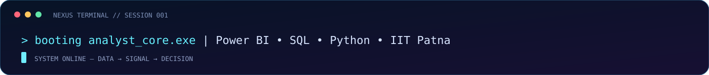
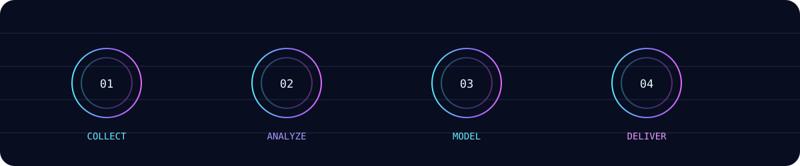
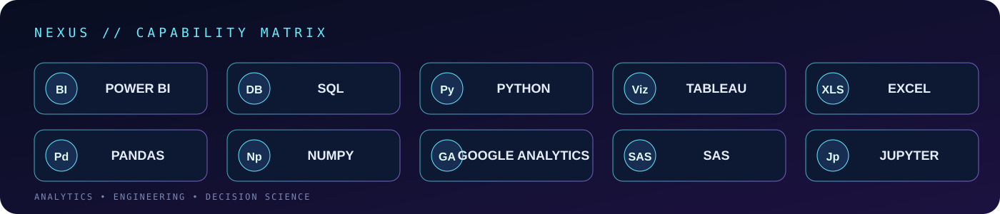
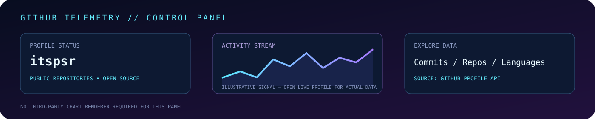
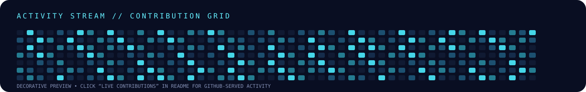

<!-- NEXUS / PRATIK KUMAR — GitHub profile README -->
<div align="center">


[**LINKEDIN ↗**](https://www.linkedin.com/in/data-by-pratik/) &nbsp; ◈ &nbsp; [**PORTFOLIO ↗**](https://placementscore.online) &nbsp; ◈ &nbsp; [**EMAIL ↗**](mailto:pratik6472@gmail.com) &nbsp; ◈ &nbsp; [**GITHUB ↗**](https://github.com/itspsr)



</div>

---

<h2 align="center">⌁ THE OPERATOR</h2>

```text
┌─[PRATIK@NEXUS]─[~/profile]
└──╼ $ whoami

  IDENTITY     Pratik Kumar
  FOCUS        Data Analytics / Business Intelligence
  EDUCATION    MBA Candidate — IIT Patna (2025–2027, expected)
  EXPERIENCE   Data Science Intern — Flip Robo Technologies
  TOOLKIT      Power BI • SQL • Python • Tableau • Excel
  APPROACH     Explore → Explain → Experiment → Execute
  DIRECTIVE    Turn raw information into useful decisions.
```

I work at the intersection of **analytics, business thinking, and technology**. My interests include building decision-support dashboards, exploring datasets, applying statistical methods, and creating practical digital products.

<div align="center">
  
</div>

---

<h2 align="center">⌁ CAPABILITY MATRIX</h2>

<div align="center">

| DOMAIN | TOOLKIT |
|:--|:--|
| **BUSINESS INTELLIGENCE** | Power BI · Tableau · Excel · Google Analytics |
| **PROGRAMMING & DATA** | Python · SQL · Jupyter · Pandas · NumPy |
| **ANALYTICS METHODS** | A/B Testing · Marketing Mix Modeling · Statistical Analysis |
| **DATA CRAFT** | Data Cleaning · Exploratory Analysis · Data Storytelling |
| **PLATFORMS** | Git · GitHub · SAS |



</div>

---

<h2 align="center">⌁ PROJECT ARCHIVE // SELECTED WORK</h2>

<details open>
<summary><b>01 — P2P Sourcing Analytics</b> · Business analytics experience</summary>

- Built Power BI dashboards and factory compliance dashboards.
- Worked with A/B experiments and marketing mix models.
- Focus: sourcing visibility, measurement, and decision support.
- *Business outcomes and quantified impact can be added when verified.*

</details>

<details>
<summary><b>02 — Data Science Internship</b> · Flip Robo Technologies</summary>

- Data Science Intern · January–July 2022.
- Machine-learning and analytics practice across multiple datasets.
- Repositories: [internship](https://github.com/itspsr/internship) · [Internship-1](https://github.com/itspsr/Internship-1)

</details>

<details>
<summary><b>03 — Evaluation Projects</b> · Machine learning & analytics</summary>

- Practice spanning classification, regression, prediction, and exploratory analysis.
- Topics include customer churn, flight prices, loan status, insurance fraud, HR attrition, and more.
- Repository: [Evaluation-Projects](https://github.com/itspsr/Evaluation-Projects)

</details>

<details>
<summary><b>04 — Class Projects</b> · Applied data exploration</summary>

- Notebook-based analysis across datasets such as Titanic, BigMart, Abalone, Mushroom, and World Happiness.
- Repository: [class-projects](https://github.com/itspsr/class-projects)

</details>

<details>
<summary><b>05 — Web Scraping</b> · Python & data collection</summary>

- Python/Jupyter exercises focused on extracting and working with web data.
- Repository: [WEB-SCRAPING](https://github.com/itspsr/WEB-SCRAPING)

</details>

<details>
<summary><b>06 — Free Claude Code</b> · Developer tooling</summary>

- A Python-based coding-agent project with provider integrations and model-routing workflows.
- Repository: [free-claude-code](https://github.com/itspsr/free-claude-code)

</details>

<details>
<summary><b>07 — P-Tek</b> · AI-powered news aggregation concept</summary>

- News aggregation project built with a Next.js-based stack.
- Repository: [p-tek](https://github.com/itspsr/p-tek)

</details>

---

<h2 align="center">⌁ GITHUB TELEMETRY</h2>

<div align="center">



<p>
  <a href="https://github.com/itspsr?tab=repositories">LIVE REPOSITORIES</a> &nbsp; ◈ &nbsp;
  <a href="https://github.com/itspsr?tab=overview">LIVE PROFILE & CONTRIBUTIONS</a> &nbsp; ◈ &nbsp;
  <a href="https://github.com/itspsr/itspsr/actions">WORKFLOW RUNS</a>
</p>

</div>

### `> contribution_city --render 3d`

<div align="center">
  
</div>

<sub>The 3D skyline is generated by the workflow in <a href="https://github.com/itspsr/itspsr/actions/workflows/profile-3d.yml">Actions</a>. Run it once manually to create the SVG.</sub>

### `> activity_stream --visualize`

<div align="center">
  
  <p><a href="https://github.com/itspsr?tab=overview#contributions-calendar">OPEN LIVE GITHUB CONTRIBUTION CALENDAR</a></p>
</div>

---

<h2 align="center">⌁ CERTIFICATION VAULT</h2>

```text
[ CREDENTIALS ]
  ◈ Certified Data Scientist
  ◈ Business Analytics with Power BI
  ◈ Business Analytics with SAS
  ◈ Introduction to Programming Using Python
  ◈ Certified Ethical Hacker (CEH)
```

---

<h2 align="center">⌁ ESTABLISH CONNECTION</h2>

<div align="center">

**Have a data problem, analytics opportunity, or interesting build in mind?**

[](https://www.linkedin.com/in/data-by-pratik/)
[](mailto:pratik6472@gmail.com)
[](https://placementscore.online)


<sub>GitHub profile READMEs support images and Markdown, but do not execute custom JavaScript, WebGL, or scroll-triggered animations. External widgets depend on their hosting services.</sub>

</div>
