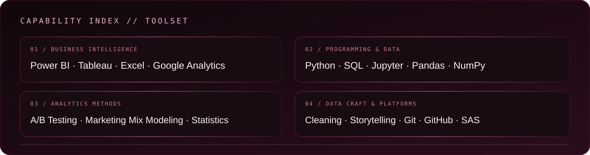
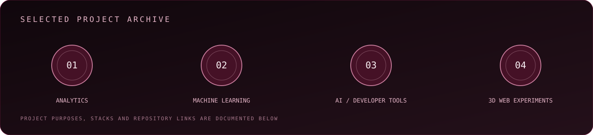
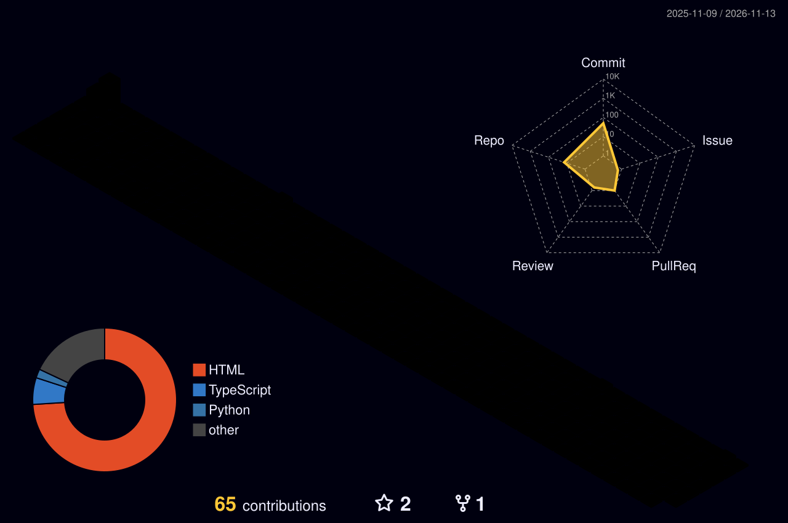

[**LINKEDIN ↗**](https://www.linkedin.com/in/data-by-pratik/) · [**PORTFOLIO ↗**](https://itspsr.github.io/) · [**PLACEMENTSCORE ↗**](https://placementscore.online) · [**EMAIL ↗**](mailto:pratik6472@gmail.com) · [**GITHUB ↗**](https://github.com/itspsr)

---

## 01 / ABOUT

I work at the intersection of **data, business thinking, and technology**. My focus is turning raw information into useful decisions through business intelligence, analytics, and practical software projects.

| PROFILE | DETAILS |
|:--|:--|
| Name | Pratik Kumar |
| Focus | Data Analytics / Business Intelligence |
| Builder track | Python Developer / AI Product Builder |
| Education | MBA Candidate — IIT Patna (2025–2027, expected) |
| Previous education | BBA — completed December 2019 |
| Experience | Data Science Intern — Flip Robo Technologies (Jan–Jul 2022) |

---

## 02 / CAPABILITY INDEX

  

**Business Intelligence:** Power BI · Tableau · Excel · Google Analytics  
**Programming & Data:** Python · SQL · R · Machine Learning  
**Analytics Methods:** A/B Testing · Marketing Mix Modeling · Statistical Analysis  
**Data Craft:** Data Cleaning · Exploratory Analysis · Data Storytelling

---

## 03 / SELECTED WORK

  

<b>01 — P2P Sourcing Analytics</b> · Professional analytics experience

- Built Power BI dashboards and factory compliance dashboards.
- Worked with A/B experiments and marketing mix models.
- Focus: sourcing visibility, measurement, and decision support.
- This is professional project experience; no public repository or quantified outcome is claimed.

<b>02 — Free Claude Code</b> · Developer tooling

- Python-based coding-agent project with provider integrations and model-routing workflows.
- Repository: [itspsr/free-claude-code](https://github.com/itspsr/free-claude-code)

<b>03 — P-Tek</b> · News aggregation product concept

- Next.js-based news aggregation project with RSS source parsing and periodic content refresh.
- Repository: [itspsr/p-tek](https://github.com/itspsr/p-tek)

<b>04 — Evaluation Projects</b> · Machine learning and analytics

- Notebook-based practice spanning classification, regression, prediction, and exploratory analysis.
- Topics include customer churn, flight prices, loan status, insurance fraud, HR attrition, and more.
- Repository: [itspsr/Evaluation-Projects](https://github.com/itspsr/Evaluation-Projects)

<b>05 — Data Science Internship Work</b> · Flip Robo Technologies

- Data Science Intern · January–July 2022.
- Public internship repository with machine-learning and analytics exercises.
- Repository: [itspsr/internship](https://github.com/itspsr/internship)

<b>06 — Class Projects</b> · Applied data exploration

- Notebook-based work across Titanic, BigMart, Abalone, Mushroom, advertisement, red wine, and World Happiness datasets.
- Repository: [itspsr/class-projects](https://github.com/itspsr/class-projects)

<b>07 — Web Scraping</b> · Python and data collection

- Python and Jupyter notebook exercises focused on extracting and working with web data.
- Repository: [itspsr/WEB-SCRAPING](https://github.com/itspsr/WEB-SCRAPING)

<b>08 — Holoverse Universe Explorer</b> · Interactive 3D web experiment

- JavaScript, HTML, and CSS-based 3D universe exploration project.
- Repository: [itspsr/Holoverse-Universe-Explorer](https://github.com/itspsr/Holoverse-Universe-Explorer)

---

## 04 / PROFESSIONAL EXPERIENCE

**Data Science Intern — Flip Robo Technologies**  
*January 2022 – July 2022*

Worked on data science and machine-learning exercises, with public project work available in the [internship repository](https://github.com/itspsr/internship).

**P2P Sourcing Analytics — Project Experience**

Worked on Power BI dashboards, factory compliance dashboards, A/B experiments, and marketing mix models.

---

## 05 / CERTIFICATIONS

- Certified Data Scientist
- Business Analytics with Power BI
- Business Analytics with SAS
- Introduction to Programming Using Python
- Certified Ethical Hacker (CEH)

---

## 06 / GITHUB CONTRIBUTION ARCHITECTURE

  

[**VIEW LIVE CONTRIBUTION CALENDAR ↗**](https://github.com/itspsr?tab=overview) · [**3D GRAPH WORKFLOW ↗**](https://github.com/itspsr/itspsr/actions/workflows/profile-3d.yml)

The 3D skyline uses GitHub contribution data generated by the existing profile repository workflow. It is not a decorative activity illustration.

---

## 07 / CONNECT

**Interested in analytics, business intelligence, or building useful technology?**

[**LINKEDIN**](https://www.linkedin.com/in/data-by-pratik/) · [**PORTFOLIO**](https://itspsr.github.io/) · [**PLACEMENTSCORE**](https://placementscore.online) · [**EMAIL**](mailto:pratik6472@gmail.com) · [**GITHUB**](https://github.com/itspsr)

Premium burgundy identity · GitHub-compatible Markdown, HTML and SVG

